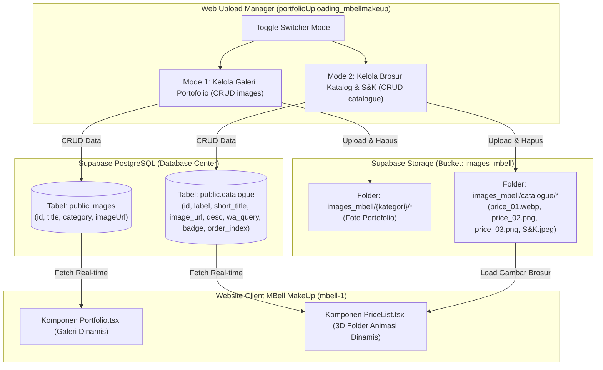

# 📑 Rencana Aksi & Arsitektur: Integrasi Tabel Catalogue & Multi-Mode CRUD MBell MakeUp

Dokumen ini memuat rencana kerja terstruktur, rancangan skema database, skrip SQL lengkap, serta arsitektur antarmuka pengguna untuk menghubungkan **Katalog Brosur Pricelist & S&K** secara dinamis antara **Supabase Database/Storage**, website utama **`mbell-1`**, dan dashboard admin **`portfolioUploading_mbellmakeup`**.

---

## 🎯 1. Ringkasan Kebutuhan & Target Proyek

| Komponen | Kondisi Saat Ini (Kekurangan) | Target yang Akan Dicapai |
|:---|:---|:---|
| **Supabase Database** | Belum ada tabel `catalogue`, file brosur sudah ada di bucket storage `images_mbell/catalogue/`. | Dibuatkan tabel `public.catalogue` lengkap dengan RLS Policies, Grant Permissions, Indexing, dan data awal (*seed data*). |
| **Website Utama (`mbell-1`)** | Komponen [`PriceList.tsx`](file:///C:/codingVibes/myPortfolio/mbell/mbell-1/src/components/PriceList.tsx) masih menggunakan data statis/hardcode (`PACKAGES`). | Otomatis mengambil data brosur dari tabel Supabase `catalogue` secara dinamis, dengan *fallback* aman jika offline. |
| **Web Upload (`portfolioUploading_mbellmakeup`)** | Hanya mengelola tabel portofolio `images`. | Ditambahkan **Toggle Mode Switcher**: beralih antara **Mode Portofolio** (`images`) dan **Mode Katalog & Pricelist** (`catalogue`). |

---

## 🏗️ 2. Arsitektur Alur Data (Data Flow Architecture)



---

## 🗄️ 3. Desain Skema Database (`public.catalogue`)

Tabel `catalogue` dirancang selaras dengan tipe data `PackageItem` pada [`PriceList.tsx`](file:///C:/codingVibes/myPortfolio/mbell/mbell-1/src/components/PriceList.tsx#L13-L21):

```sql
-- ============================================================================
-- SKRIP DDL & PERMISSIONS: TABEL public.catalogue
-- Jalankan skrip ini di Supabase SQL Editor
-- ============================================================================

-- 1. Buat Tabel public.catalogue
CREATE TABLE IF NOT EXISTS public.catalogue (
    id BIGINT GENERATED BY DEFAULT AS IDENTITY PRIMARY KEY,
    label VARCHAR(100) NOT NULL,              -- Contoh: 'Katalog Paket 1', 'Syarat & Ketentuan'
    short_title VARCHAR(80) NOT NULL,         -- Contoh: 'Wedding & Akad', 'Ketentuan & DP'
    image_url TEXT NOT NULL,                  -- URL file di bucket images_mbell/catalogue/...
    description TEXT,                         -- Deskripsi rincian paket/layanan
    wa_query TEXT,                            -- Template otomatis pesan konsultasi WhatsApp
    badge VARCHAR(50) DEFAULT 'Popular',      -- Label pill: 'Popular', 'Favorite', 'Penting', dll.
    order_index INT4 DEFAULT 0,               -- Urutan tampil pada animasi folder (1, 2, 3, 4)
    created_at TIMESTAMPTZ DEFAULT NOW(),
    updated_at TIMESTAMPTZ DEFAULT NOW()
);

-- 2. Index Performa untuk Pengurutan Folder
CREATE INDEX IF NOT EXISTS idx_catalogue_order ON public.catalogue (order_index ASC, id ASC);

-- 3. Berikan Hak Akses (GRANT) ke Role anon, authenticated, service_role
GRANT ALL ON TABLE public.catalogue TO anon, authenticated, service_role;
GRANT ALL ON ALL SEQUENCES IN SCHEMA public TO anon, authenticated, service_role;

-- 4. Konfigurasi Row Level Security (RLS)
ALTER TABLE public.catalogue ENABLE ROW LEVEL SECURITY;

-- Policy SELECT (Membaca data katalog untuk publik & website utama)
DROP POLICY IF EXISTS "Allow public select on catalogue" ON public.catalogue;
CREATE POLICY "Allow public select on catalogue"
ON public.catalogue FOR SELECT TO anon, authenticated, service_role USING (true);

-- Policy INSERT (Tambah brosur katalog baru)
DROP POLICY IF EXISTS "Allow public insert on catalogue" ON public.catalogue;
CREATE POLICY "Allow public insert on catalogue"
ON public.catalogue FOR INSERT TO anon, authenticated, service_role WITH CHECK (true);

-- Policy UPDATE (Edit teks, judul, urutan, atau ganti gambar katalog)
DROP POLICY IF EXISTS "Allow public update on catalogue" ON public.catalogue;
CREATE POLICY "Allow public update on catalogue"
ON public.catalogue FOR UPDATE TO anon, authenticated, service_role USING (true) WITH CHECK (true);

-- Policy DELETE (Hapus paket katalog)
DROP POLICY IF EXISTS "Allow public delete on catalogue" ON public.catalogue;
CREATE POLICY "Allow public delete on catalogue"
ON public.catalogue FOR DELETE TO anon, authenticated, service_role USING (true);

-- 5. Seed Data Awal (Menggunakan 4 File yang Sudah Ada di Bucket Storage)
INSERT INTO public.catalogue (label, short_title, image_url, description, wa_query, badge, order_index)
VALUES
(
    'Katalog Paket 1',
    'Wedding & Akad',
    'https://fsbvnkwxwvffghrdxnxr.supabase.co/storage/v1/object/public/images_mbell/catalogue/price_01.webp',
    'Paket riasan pengantin, prosesi akad nikah, resepsi, dan riasan pendamping keluarga.',
    'Halo MBell MakeUp, saya ingin konsultasi mengenai Paket 1 (Wedding & Akad). Boleh minta info detail ketersediaan tanggal dan layanannya?',
    'Popular',
    1
),
(
    'Katalog Paket 2',
    'Wisuda & Lamaran',
    'https://fsbvnkwxwvffghrdxnxr.supabase.co/storage/v1/object/public/images_mbell/catalogue/price_02.png',
    'Pilihan riasan wisuda, sesi lamaran (engagement), pre-wedding, dan acara pesta spesial.',
    'Halo MBell MakeUp, saya tertarik dengan Paket 2 (Wisuda, Lamaran, & Pesta). Apakah ada slot kosong untuk tanggal acara saya?',
    'Favorite',
    2
),
(
    'Katalog Paket 3',
    'Layanan Tambahan',
    'https://fsbvnkwxwvffghrdxnxr.supabase.co/storage/v1/object/public/images_mbell/catalogue/price_03.png',
    'Riasan keluarga, bridesmaid, hijab do / hair do, dan paket rombongan acara.',
    'Halo MBell MakeUp, saya mau tanya rincian Paket 3 (Layanan Tambahan & Bridesmaid). Mohon info lengkapnya ya kak.',
    'Lengkap',
    3
),
(
    'Syarat & Ketentuan',
    'Ketentuan & DP',
    'https://fsbvnkwxwvffghrdxnxr.supabase.co/storage/v1/object/public/images_mbell/catalogue/S&K.jpeg',
    'Panduan tata cara booking jadwal, ketentuan uang muka (DP), pelunasan, dan kebijakan layanan.',
    'Halo MBell MakeUp, saya sudah membaca Syarat & Ketentuan dan ingin melakukan booking jadwal makeup.',
    'Penting',
    4
)
ON CONFLICT DO NOTHING;
```

---

## 💻 4. Rencana Implementasi di Website Client (`mbell-1`)

Berkas target: [`C:\codingVibes\myPortfolio\mbell\mbell-1\src\components\PriceList.tsx`](file:///C:/codingVibes/myPortfolio/mbell/mbell-1/src/components/PriceList.tsx)

1. **State Dinamis dengan Fallback Aman**:
   - Menambahkan state `const [packages, setPackages] = useState<PackageItem[]>(PACKAGES);`.
   - Data statis `PACKAGES` yang sudah ada tetap dipertahankan sebagai cadangan (*fallback items*) bila jaringan seluler klien terputus atau query gagal.
2. **Fetch Data Real-Time dari Supabase**:
   ```typescript
   useEffect(() => {
     let isMounted = true;
     const fetchCatalogue = async () => {
       try {
         const { data, error } = await supabase
           .from('catalogue')
           .select('*')
           .order('order_index', { ascending: true });
         
         if (!error && data && data.length > 0 && isMounted) {
           const mapped: PackageItem[] = data.map(item => ({
             id: String(item.id),
             label: item.label,
             shortTitle: item.short_title,
             image: item.image_url,
             desc: item.description || '',
             waQuery: item.wa_query || `Halo MBell MakeUp, saya ingin tanya mengenai ${item.label}`,
             badge: item.badge || undefined
           }));
           setPackages(mapped);
           setActiveTab(mapped[0]);
         }
       } catch (err) {
         console.warn('Gagal memuat katalog dari Supabase, menggunakan data cadangan:', err);
       }
     };
     fetchCatalogue();
     return () => { isMounted = false; };
   }, []);
   ```
3. **Reaktivitas 3D Folder Animation**:
   - `folderItems` diperbarui menjadi bergantung pada state `packages`: `useMemo(() => packages.map(...), [packages])`.
   - Download gambar brosur (`handleDownloadCatalog`), zoom brosur (`handleZoom`), dan pesan WhatsApp (`handleWhatsAppBooking`) otomatis membaca data dinamis dari database.

---

## 🎛️ 5. Rencana Implementasi di Web Upload (`portfolioUploading_mbellmakeup`)

Berkas target:
- [`config.js`](file:///C:/codingVibes/myPortfolio/mbell/portfolioUploading_mbellmakeup/config.js)
- [`supabase-service.js`](file:///C:/codingVibes/myPortfolio/mbell/portfolioUploading_mbellmakeup/supabase-service.js)
- [`index.html`](file:///C:/codingVibes/myPortfolio/mbell/portfolioUploading_mbellmakeup/index.html)
- [`style.css`](file:///C:/codingVibes/myPortfolio/mbell/portfolioUploading_mbellmakeup/style.css)
- [`app.js`](file:///C:/codingVibes/myPortfolio/mbell/portfolioUploading_mbellmakeup/app.js)

### A. Fitur Navigasi Mode Switcher (Tab Toggle)
Pada header atas web uploader, ditambahkan switcher mode:
- `[🖼️ Galeri Portofolio]` (Default / Mode Aktif Saat Ini)
- `[📑 Katalog & Brosur]` (Mode Baru)

### B. Tampilan Khusus Mode Katalog (`#catalogueView`)
Saat mode Katalog diaktifkan:
1. **Panel Kiri: Upload Brosur Katalog Baru**:
   - Dropzone khusus file brosur (WebP, PNG, JPG).
   - Input:
     - Judul Paket (`label`), misal: `Katalog Paket 4`.
     - Sub-Judul (`short_title`), misal: `Prewedding Outdoor`.
     - Badge/Tag (`badge`), pilihan: `Popular`, `Favorite`, `Lengkap`, `Promo`, `Penting`.
     - Urutan Tampilan (`order_index`), angka urutan 1, 2, 3...
     - Deskripsi Paket (`description`).
     - Template Chat WhatsApp (`wa_query`).
   - Tombol `Unggah Brosur Katalog`.
2. **Panel Kanan: Daftar Brosur Katalog Aktif**:
   - Grid kartu brosur dengan preview gambar brosur memanjang ke bawah (aspek rasio brosur 3:4 atau 9:16).
   - Info nomor urut brosur (`#1`, `#2`, dst.), badge, judul, dan deskripsi singkat.
   - Tombol Aksi per Kartu:
     - 👁️ **Perbesar / Preview** (Lightbox).
     - ✏️ **Edit Detail Brosur** (Modal: ubah judul, teks WA, urutan, atau ganti file gambar).
     - 🗑️ **Hapus Brosur** (Hapus dari tabel `catalogue` dan file dari bucket `images_mbell/catalogue/`).

### C. Pembaruan Service Layer ([`supabase-service.js`](file:///C:/codingVibes/myPortfolio/mbell/portfolioUploading_mbellmakeup/supabase-service.js))
Menambahkan method spesifik untuk katalog:
- `getCatalogues()`: Mengambil semua data dari tabel `catalogue` terurut berdasarkan `order_index ASC`.
- `uploadCatalogue(file, metadata)`: Upload gambar ke `images_mbell/catalogue/{nama_file}`, lalu insert ke `public.catalogue`.
- `updateCatalogue(id, updates, newFile)`: Update kolom tabel, dan jika ada file baru, hapus file lama di storage dan upload file baru.
- `deleteCatalogue(id, imageUrl)`: Hapus baris di `public.catalogue` dan hapus file fisik di folder `catalogue/`.

---

## 📋 6. Tahapan Eksekusi Bertahap (Action Plan)

- [ ] **Fase 1: Setup Database & Storage di Supabase**
  - Buat file SQL di proyek dan sediakan skrip SQL untuk dieksekusi di Supabase SQL Editor.
  - Verifikasi tabel `catalogue`, RLS policies, dan 4 data seed awal.
- [ ] **Fase 2: Integrasi Dinamis di Website Utama (`mbell-1`)**
  - Update `mbell-1/src/components/PriceList.tsx` untuk mengambil data dari Supabase.
  - Lakukan test build (`npm run build` / typecheck) pada `mbell-1` untuk memastikan 100% bebas error TypeScript.
- [ ] **Fase 3: Service Layer & Konfigurasi di Web Upload**
  - Update `config.js` untuk menambahkan konstanta `TABLE_CATALOGUE: 'catalogue'` dan `CATALOGUE_FOLDER: 'catalogue'`.
  - Tambahkan fungsi CRUD `getCatalogues`, `uploadCatalogue`, `updateCatalogue`, `deleteCatalogue` di `supabase-service.js`.
- [ ] **Fase 4: Markup & Styling UI Mode Switcher di Web Upload**
  - Tambahkan tombol toggle switcher mode di header `index.html`.
  - Tambahkan section tampilan `#catalogueView` berdampingan dengan `#portfolioView`.
  - Tambahkan modal edit brosur katalog `#editCatalogueModal`.
  - Tambahkan styling responsif modern luxury rosewood di `style.css`.
- [ ] **Fase 5: Kontroler Logika & State di `app.js`**
  - Implementasikan event handler pergantian mode (Portfolio $\leftrightarrow$ Catalogue).
  - Implementasikan upload brosur katalog, render daftar katalog, modal edit, dan hapus.
- [ ] **Fase 6: Pengujian End-to-End & Verifikasi**
  - Uji upload brosur baru di web uploader $\rightarrow$ pastikan langsung muncul di PriceList website `mbell-1`.
  - Uji edit urutan atau judul $\rightarrow$ pastikan animasi folder dan tombol WA di `mbell-1` langsung menyesuaikan.

---

> [!NOTE]
> Perubahan ini didesain **non-breaking**: Data portofolio (`images`) yang sudah berjalan tetap utuh 100%, dan jika koneksi internet terputus di website klien `mbell-1`, PriceList memiliki *fallback* otomatis ke data brosur lokal.
