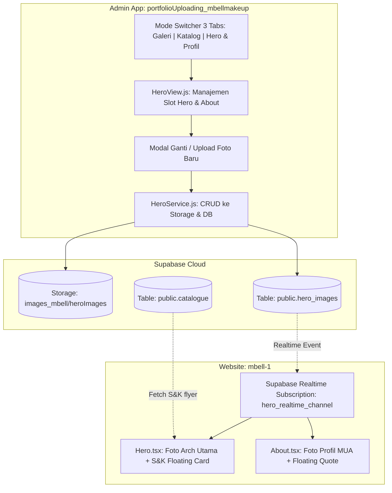

# 📋 Perencanaan Arsitektur & Integrasi: Mode 3 CRUD Foto Hero, Profil About & S&K

Dokumen ini merinci rancangan integrasi fitur **Mode Switch ke-3: CRUD Foto Hero & Profil** pada dashboard admin (`portfolioUploading_mbellmakeup`) dan sinkronisasi dinamis di website utama (`mbell-1`).

---

## 1. Analisis Kebutuhan & Relasi Data

Berdasarkan screenshot dan instruksi yang diberikan:
1. **Foto Utama Hero (Arch Portrait)**:
   - File tersimpan di folder Supabase Storage: `images_mbell/heroImages/foto_1_opt.jpeg`
   - Ditampilkan pada komponen [`Hero.tsx`](file:///c:/codingVibes/myPortfolio/mbell/mbell-1/src/components/Hero.tsx) (bingkai kubah melengkung / *organic arch*, aspect ratio 4:5).
   - Memiliki badge status: `"Certified MUA"`.
2. **Foto Profil About / Main**:
   - File tersimpan di folder Supabase Storage: `images_mbell/heroImages/foto_2_opt.jpeg`
   - Ditampilkan pada komponen [`About.tsx`](file:///c:/codingVibes/myPortfolio/mbell/mbell-1/src/components/About.tsx) (foto Bella sedang merias klien).
   - Memiliki floating quote: `"Kecantikan alami adalah karakter terbaikmu. — Bella Aprilian"`.
3. **Foto Kecil Mengambang di Hero (Floating Thumbnail)**:
   - Seperti instruksi catatan: foto kecil ini mengambil flyer **Syarat & Ketentuan (S&K)** langsung dari tabel Supabase `catalogue` (`order_index = 4` / `short_title = 'Ketentuan & DP'`).
   - Tidak perlu tabel baru terpisah untuk foto kecil ini, cukup ditautkan dinamis dari tabel `catalogue`.
4. **Switch Mode ke-3 di Admin Uploader**:
   - Mode 1: `[🖼️ Galeri Portofolio]` (Tabel `images`)
   - Mode 2: `[📑 Katalog & Brosur]` (Tabel `catalogue`)
   - Mode 3: `[✨ Foto Hero & Profil]` (Tabel baru `hero_images`)

---

## 2. SQL Schema & RLS Policies (Postgres Supabase)

Jalankan script SQL berikut di **Supabase SQL Editor**:

```sql
-- ============================================================================
-- 1. TABEL: hero_images (Manajemen Foto Hero, Banner, & Profil About)
-- ============================================================================
CREATE TABLE IF NOT EXISTS public.hero_images (
  id BIGINT GENERATED BY DEFAULT AS IDENTITY PRIMARY KEY,
  key VARCHAR(50) UNIQUE NOT NULL,             -- Identifier unik (misal: 'hero_main', 'about_main')
  title VARCHAR(150) NOT NULL,                 -- Judul section / nama slot foto
  subtitle VARCHAR(150),                       -- Subtitle / teks badge (misal: 'Certified MUA')
  image_url TEXT NOT NULL,                     -- URL publik gambar di Supabase Storage
  alt_text VARCHAR(255),                       -- Teks aksesibilitas alt gambar
  description TEXT,                            -- Keterangan / quote pendukung
  is_active BOOLEAN DEFAULT TRUE,              -- Status aktif tampilan
  order_index INT DEFAULT 1,                   -- Urutan tampilan
  created_at TIMESTAMPTZ DEFAULT NOW(),
  updated_at TIMESTAMPTZ DEFAULT NOW()
);

-- Index pencarian cepat berdasarkan key dan status aktif
CREATE INDEX IF NOT EXISTS idx_hero_images_key ON public.hero_images (key);
CREATE INDEX IF NOT EXISTS idx_hero_images_active ON public.hero_images (is_active, order_index);

-- Trigger otomatis update kolom updated_at
CREATE OR REPLACE FUNCTION public.handle_hero_images_updated_at()
RETURNS TRIGGER AS $$
BEGIN
  NEW.updated_at = NOW();
  RETURN NEW;
END;
$$ LANGUAGE plpgsql;

DROP TRIGGER IF EXISTS set_hero_images_updated_at ON public.hero_images;
CREATE TRIGGER set_hero_images_updated_at
BEFORE UPDATE ON public.hero_images
FOR EACH ROW
EXECUTE FUNCTION public.handle_hero_images_updated_at();

-- ============================================================================
-- 2. ROW LEVEL SECURITY (RLS) POLICIES
-- ============================================================================
ALTER TABLE public.hero_images ENABLE ROW LEVEL SECURITY;

-- Policy 1: Siapa saja (public & anon) boleh membaca/melihat data
DROP POLICY IF EXISTS "Public can read hero_images" ON public.hero_images;
CREATE POLICY "Public can read hero_images"
ON public.hero_images
FOR SELECT
USING (true);

-- Policy 2: Izinkan Admin (anon key yang terverifikasi) menambah data
DROP POLICY IF EXISTS "Allow insert on hero_images" ON public.hero_images;
CREATE POLICY "Allow insert on hero_images"
ON public.hero_images
FOR INSERT
WITH CHECK (true);

-- Policy 3: Izinkan Admin mengubah data foto hero & profil
DROP POLICY IF EXISTS "Allow update on hero_images" ON public.hero_images;
CREATE POLICY "Allow update on hero_images"
ON public.hero_images
FOR UPDATE
USING (true)
WITH CHECK (true);

-- Policy 4: Izinkan Admin menghapus record foto
DROP POLICY IF EXISTS "Allow delete on hero_images" ON public.hero_images;
CREATE POLICY "Allow delete on hero_images"
ON public.hero_images
FOR DELETE
USING (true);

-- ============================================================================
-- 3. STORAGE BUCKET POLICIES (Folder 'heroImages' di bucket 'images_mbell')
-- ============================================================================
-- Pastikan bucket images_mbell mengizinkan upload dan akses publik di folder heroImages/
DROP POLICY IF EXISTS "Public can view heroImages storage" ON storage.objects;
CREATE POLICY "Public can view heroImages storage"
ON storage.objects FOR SELECT
USING (bucket_id = 'images_mbell' AND (storage.foldername(name))[1] = 'heroImages');

DROP POLICY IF EXISTS "Allow insert heroImages storage" ON storage.objects;
CREATE POLICY "Allow insert heroImages storage"
ON storage.objects FOR INSERT
WITH CHECK (bucket_id = 'images_mbell' AND (storage.foldername(name))[1] = 'heroImages');

DROP POLICY IF EXISTS "Allow update heroImages storage" ON storage.objects;
CREATE POLICY "Allow update heroImages storage"
ON storage.objects FOR UPDATE
USING (bucket_id = 'images_mbell' AND (storage.foldername(name))[1] = 'heroImages');

DROP POLICY IF EXISTS "Allow delete heroImages storage" ON storage.objects;
CREATE POLICY "Allow delete heroImages storage"
ON storage.objects FOR DELETE
USING (bucket_id = 'images_mbell' AND (storage.foldername(name))[1] = 'heroImages');

-- ============================================================================
-- 4. INITIAL SEED DATA (Menggunakan 2 file yang sudah diunggah user)
-- ============================================================================
INSERT INTO public.hero_images (key, title, subtitle, image_url, alt_text, description, order_index)
VALUES
  (
    'hero_main',
    'Foto Utama Hero (Organic Arch)',
    'Certified MUA',
    'https://fsbvnkwxwvffghrdxnxr.supabase.co/storage/v1/object/public/images_mbell/heroImages/foto_1_opt.jpeg',
    'Hasil riasan profesional MBell MakeUp di bagian Hero',
    'Foto portrait utama dengan kubah melengkung di halaman depan website.',
    1
  ),
  (
    'about_main',
    'Foto Profil About (Bella Makeup Artist)',
    'Founder & Lead MUA',
    'https://fsbvnkwxwvffghrdxnxr.supabase.co/storage/v1/object/public/images_mbell/heroImages/foto_2_opt.jpeg',
    'Bella Aprilian sedang merias klien di bagian About',
    'Kecantikan alami adalah karakter terbaikmu. — Bella Aprilian',
    2
  )
ON CONFLICT (key) DO UPDATE
SET
  title = EXCLUDED.title,
  subtitle = EXCLUDED.subtitle,
  image_url = EXCLUDED.image_url,
  alt_text = EXCLUDED.alt_text,
  description = EXCLUDED.description,
  updated_at = NOW();

-- Enable Supabase Realtime untuk tabel hero_images
ALTER PUBLICATION supabase_realtime ADD TABLE public.hero_images;
```

---

## 3. Desain Komponen & Alur Kerja



---

## 4. Rincian Modifikasi File Proyek

### A. Aplikasi Pengelola (`portfolioUploading_mbellmakeup`)
1. **`build-config.js` & `js/config.js`**:
   - Menambahkan konstanta `TABLE_HERO: 'hero_images'` dan `HERO_FOLDER: 'heroImages'`.
2. **`index.html`**:
   - Menambahkan tombol tab ke-3 di `#modeSwitcherContainer`:
     ```html
     <button type="button" class="mode-tab" id="tabModeHero" data-mode="hero">
       <span class="mode-icon">✨</span>
       <span class="mode-label">Hero & Profil</span>
     </button>
     ```
   - Menambahkan tampilan view ke-3: `<div id="heroView" class="view-container hidden-view">...</div>`.
   - Menambahkan slot kartu visual:
     - **Slot 1 (Hero Arch)**: Tampilan visual kubah mini, preview live `foto_1_opt.jpeg`, badge "Certified MUA", tombol *Ganti Foto*, *Lihat Fullscreen*, dan *Edit Detail*.
     - **Slot 2 (About MUA)**: Tampilan visual kartu 4:5, preview live `foto_2_opt.jpeg`, quote Bella, tombol *Ganti Foto*, *Lihat Fullscreen*, dan *Edit Detail*.
     - **Slot 3 (Informasi S&K Mini Hero)**: Preview mini flyer S&K dari tabel katalog, dengan badge *"Terhubung Otomatis ke Katalog S&K"*, plus tombol shortcut untuk lompat langsung ke tab Katalog.
   - Menambahkan Modal: `#editHeroModal` untuk upload file baru dan mengedit teks badge / deskripsi.
3. **`js/services/HeroService.js`**:
   - Service OOP untuk mengambil data `hero_images`, mengunggah file baru ke folder `images_mbell/heroImages/`, dan meng-update record database.
4. **`js/components/HeroView.js`**:
   - Mengelola rendering kartu slot, event modal edit/upload, preview thumbnail, dan validasi file.
5. **`css/components/catalogue.css` & `css/components/hero-manager.css`**:
   - Styling 3-tab responsive untuk desktop dan floating bar bawah mobile.
   - Pada layar mobile (`≤ 860px`), ketiga tombol (`🖼️ Galeri`, `📑 Katalog`, `✨ Hero`) dirancang seimbang (`flex: 1`) dengan ikon dan teks proporsional agar pas sempurna tanpa tumpang tindih.

### B. Website Utama (`mbell-1`)
1. **`src/components/Hero.tsx`**:
   - Mengambil data foto utama dari `supabase.from('hero_images').select('*').eq('key', 'hero_main').maybeSingle()`.
   - Mengambil foto kecil S&K dari `supabase.from('catalogue').select('image_url').ilike('label', '%Syarat%').maybeSingle()`.
   - Berlangganan ke Supabase Realtime channel (`hero_realtime_channel`) agar perubahan foto hero langsung tampak di browser pengunjung tanpa reload.
   - Menghapus import lokal `foto_1_opt.jpeg` dan `akad-makeup.jpeg`.
2. **`src/components/About.tsx`**:
   - Mengambil foto profil dari `supabase.from('hero_images').select('*').eq('key', 'about_main').maybeSingle()`.
   - Berlangganan ke Supabase Realtime.
   - Menghapus import lokal `foto_2_opt.jpeg`.

---

## 5. Rencana Eksekusi Bertahap

- [ ] **Langkah 1**: User menjalankan script SQL di Supabase SQL Editor.
- [ ] **Langkah 2**: Perbarui konfigurasi & buat `HeroService.js` di `portfolioUploading_mbellmakeup`.
- [ ] **Langkah 3**: Buat `HeroView.js` dan tambahkan markup `#heroView` serta tab ke-3 di `index.html`.
- [ ] **Langkah 4**: Sesuaikan CSS 3-tab floating bottom bar pada mobile agar proporsional dan elegan.
- [ ] **Langkah 5**: Hubungkan `Hero.tsx` dan `About.tsx` di `mbell-1` ke tabel Supabase `hero_images` dan `catalogue`.
- [ ] **Langkah 6**: Verifikasi build `npm run build` dan uji pergantian foto melalui dashboard admin.

